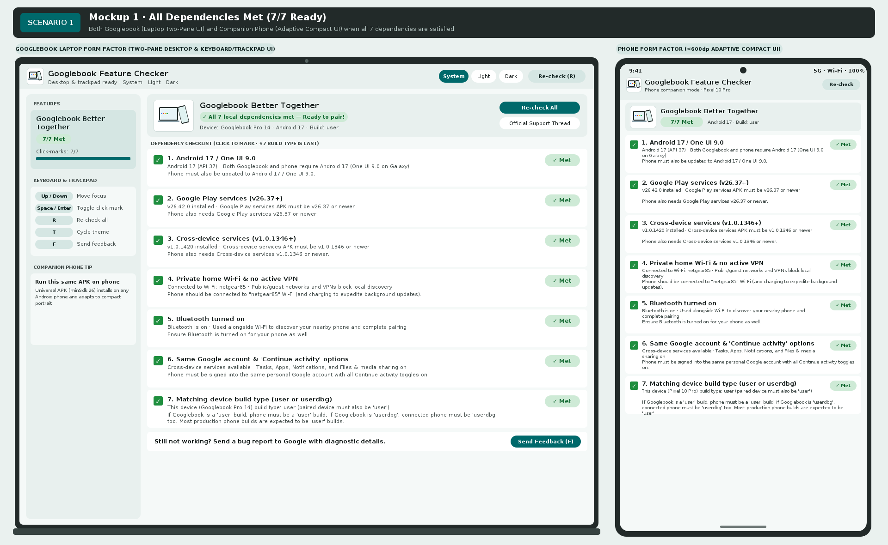
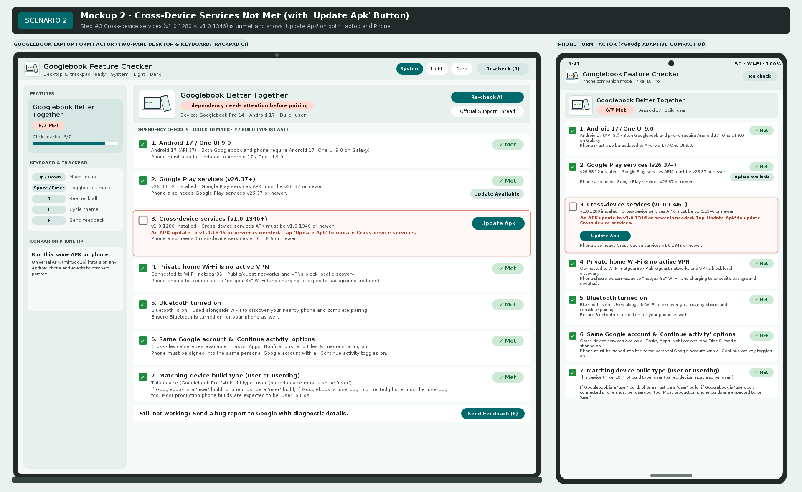
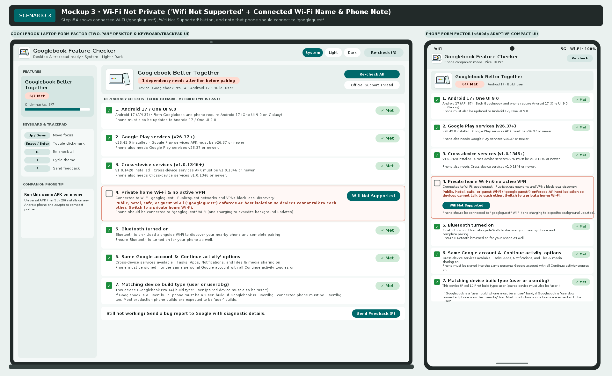

# Googlebook Feature Checker


**Googlebook Feature Checker** is the overall **feature dependency tracker and dependency fixer for complex Googlebook features**.

Modern Googlebook capabilities often span multiple OS versions, system APKs, local network conditions, account settings, and device build configurations. **Googlebook Feature Checker** provides **step-by-step guidance** to track every prerequisite for a selected Googlebook feature, automatically check whether each dependency is met on the device, and help users fix any unmet requirement on the spot.

### Feature Support & Roadmap
- **v1.0 — Googlebook Better Together (with Companion Phones)**: Full step-by-step dependency tracking and fixing for pairing a Googlebook laptop with an Android phone ([official Googlebook Community rollout reference](https://support.google.com/googlebook/thread/472325070/update-on-better-together-setup-samsung-galaxy-rollout-on-googlebook?hl=en-GB)).
- **Future Releases — Additional Complex Googlebook Features**: Built around an extensible multi-feature navigation sidebar and modular checklist engine so new Googlebook features and their dependency trees can be added seamlessly over time.

### Adaptive Across Googlebook Laptops & Phones
Designed in the **Googlebook Studio** (*HearOn Link* by Fika Labs) visual language, a single universal APK (`minSdk = 26`) runs natively on both:
- **Googlebook Laptops (`>= 600dp`)**: Two-pane desktop layout with a feature selector sidebar, step-by-step dependency checklist, and full keyboard & trackpad navigation (`↑`/`↓`, `Space`/`Enter`, `R`, `T`, `F`).
- **Android Companion Phones (`< 600dp`)**: Adaptive single-column portrait UI so users can install the exact same APK on their phone to track and fix phone-side dependencies when cross-device features require companion phone readiness.

---

## UI Mocks: Googlebook Laptop & Phone Form Factors

Every scenario below displays both the **Googlebook Laptop (Two-Pane Desktop UI)** on the left and the **Companion Phone (`< 600dp` Adaptive Compact UI)** on the right.

### 1. All Dependencies Met (`7/7 Ready`)
When all dependencies for a selected feature are satisfied, each step in the checklist displays a green **`✓`** click-mark checkbox and a green **`✓ Met`** badge with no unnecessary action buttons.
- **Step #4 (Private home Wi-Fi)** displays the connected Wi-Fi network name (`Connected to Wi-Fi: netgear85`) and reminds the user: `Phone should be connected to "netgear85" Wi-Fi (and charging to expedite background updates).`
- **Step #7 (Matching device build type)** is the **last** item in the checklist and verifies that both devices run the same build type (`user` with `user`, or `userdbg` with `userdbg`).



---

### 2. Cross-Device Services Not Met (with `Update Apk` Dependency Fixer Button)
When a required system APK such as **Cross-device services (`com.google.ambient.streaming`)** is below the required baseline (`v1.0.1280 < v1.0.1346`), Step #3 is marked unmet and presents an **`Update Apk`** button on both the Googlebook and the Phone to deep-link directly to the package updater.
- Also demonstrates the **`Update Available`** button rendered underneath the green **`✓ Met`** badge (shown on Step #2 when an APK already meets the minimum version requirement but a newer rollout version is available). When already on the latest version, only **`✓ Met`** is shown.



---

### 3. Wi-Fi Not Private (`Wifi Not Supported` + Connected Wi-Fi Name)
When connected to a public, guest, hotel, cafe, enterprise 802.1X/Passpoint, or AP host-isolated Wi-Fi network (such as `googleguest`), Step #4 triggers automatically:
- Shows the connected Wi-Fi network name (`Connected to Wi-Fi: googleguest`).
- Displays **`Wifi Not Supported`** (instead of `"Fix Wi-Fi"`).
- Includes the note that the phone should be connected to that named Wi-Fi (`Phone should be connected to "googleguest" Wi-Fi`) and explains why AP host isolation blocks local device-to-device discovery.



---

## v1.0 Feature: Googlebook Better Together Step-by-Step Checklist (`#1` – `#7`)

| Step | Dependency | Step-by-Step Verification | Action / Status When Unmet |
| :--- | :--- | :--- | :--- |
| **1** | **Android 17 / One UI 9.0** | Verifies Android 17 (`API 37` / release `17`) and Samsung One UI `9.0+` where applicable. | `System Update` |
| **2** | **Google Play services (`v26.37+`)** | Inspects `com.google.android.gms` version (`>= 26.37`). Shows `Update Available` under `✓ Met` only when a newer version is staged. | `Update Apk` |
| **3** | **Cross-device services (`v1.0.1346+`)** | Inspects `com.google.ambient.streaming` version (`>= 1.0.1346`). | `Update Apk` |
| **4** | **Private home Wi-Fi & no active VPN** | Displays connected Wi-Fi name (`palomar`, `netgear85`, `googleguest`, etc.), checks 9 AP host-isolation & public/captive/VPN heuristics, and notes the phone should connect to that named Wi-Fi. | `Wifi Not Supported` |
| **5** | **Bluetooth turned on** | Verifies local Bluetooth adapter availability and active state for proximity discovery. | `Enable Bluetooth` |
| **6** | **Same Google account & 'Continue activity'** | Verifies Cross-device services availability and guides enabling *Tasks*, *Apps*, *Notifications*, and *Files & media sharing* followed by a device restart. | `Open Cross-Device Settings` |
| **7** | **Matching device build type (`user` or `userdbg`)** | **Last item in checklist**: Reports `android.os.Build.TYPE` and enforces that if Googlebook is `user`, phone must be `user`; if Googlebook is `userdbg`, connected phone must be `userdbg` too. | `View Build Info` |

---

## Core Capabilities

- **Step-by-Step Dependency Tracker & Fixer**:
  - Lists every dependency for a Googlebook feature in logical order with interactive click-mark checkboxes, real-time detection status, explanations when a requirement is not met, and one-click fixer actions (`Update Apk`, system settings deep-links, or Google Feedback bug reporting).
- **Adaptive Desktop & Mobile Layout**:
  - **Two-Pane Desktop Mode (`>= 600dp`)**: Left feature selector & shortcut sidebar + right grouped step-by-step dependency checklist.
  - **Compact Phone Mode (`< 600dp`)**: Streamlined top bar, stacked cards, and full-width action buttons.
- **Full Keyboard & Trackpad Navigation**:
  - `↑` / `↓` (`Tab`): Move focus across dependency steps
  - `Space` / `Enter`: Toggle the green click-mark checkbox on the focused step
  - `R`: Re-check all feature dependencies
  - `T`: Cycle theme mode (`System` → `Light` → `Dark`)
  - `F`: Copy diagnostic summary and launch Google Feedback report
- **Launcher Icon**: Custom vector launcher icon featuring a white background, a Googlebook laptop, and a Pixel phone tapping from the side.

---

## Building & Running Tests

```bash
# Run unit, UI (Robolectric Compose), fuzzing, and security verification tests
./gradlew testDebugUnitTest

# Run Android Lint static analysis
./gradlew lintDebug

# Assemble universal debug APK (installable on any Googlebook or Android 8.0+ phone)
./gradlew assembleDebug
```

## License

Licensed under the [Apache License, Version 2.0](LICENSE).
